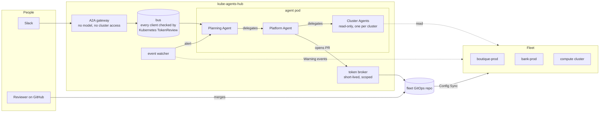

# Slide: how it's built

Simplified from kube-agents' `docs/site/src/content/docs/overview/architecture.mdx` for a single
slide. Render with `npx -p @mermaid-js/mermaid-cli mmdc -i architecture.md -o architecture.svg`.

## Talking points

- The front door has no model and no credentials. Chat becomes a task on a bus, and every bus
  client proves its Kubernetes identity first.
- One planner delegates. Specialists do the work, and each cluster gets its own read-only agent.
- The agents read everything and write nothing to a cluster. Every change is a pull request, and
  a person merges it.
- GitHub credentials are minted per task, scoped to one repository, and expire.
